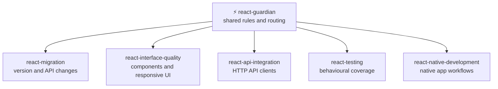

```
              ██████╗   ███████╗   █████╗    ██████╗  ████████╗
              ██╔══██╗  ██╔════╝  ██╔══██╗  ██╔════╝  ╚══██╔══╝
              ██████╔╝  █████╗    ███████║  ██║          ██║
              ██╔══██╗  ██╔══╝    ██╔══██║  ██║          ██║
              ██║  ██║  ███████╗  ██║  ██║  ██║          ██║
              ╚═╝  ╚═╝  ╚══════╝  ╚═╝  ╚═╝  ╚██████╗     ╚═╝
 ██████╗   ██╗  ██╗   █████╗   ██████╗   ██████╗   ██╗    █████╗   ███╗   ██╗
██╔════╝   ██║  ██║  ██╔══██╗  ██╔══██╗  ██╔══██╗  ██║   ██╔══██╗  ████╗  ██║
██║  ███╗  ██║  ██║  ███████║  ██████╔╝  ██║  ██║  ██║   ███████║  ██╔██╗ ██║
██║   ██║  ██║  ██║  ██╔══██║  ██╔══██╗  ██║  ██║  ██║   ██╔══██║  ██║╚██╗██║
╚██████╔╝  ╚█████╔╝  ██║  ██║  ██║  ██║  ██████╔╝  ██║   ██║  ██║  ██║ ╚████║
 ╚═════╝    ╚════╝   ╚═╝  ╚═╝  ╚═╝  ╚═╝  ╚═════╝   ╚═╝   ╚═╝  ╚═╝  ╚═╝  ╚═══╝
```

<div align="center">

# ⚡ React Guardian

</div>

Table of contents:

- [Skills](#skills)
- [How they fit together](#how-they-fit-together)
- [Install](#install)
- [Usage](#usage)
- [Optional agent profiles](#optional-agent-profiles)
- [Validate](#validate)
- [Layout](#layout)
- [Status and limits](#status-and-limits)

---

<div align="center">

**Focused, evidence-based skills for React web and native applications.**

</div>

> [!IMPORTANT]
> **Principle: Preserve user-visible behaviour, accessibility, and the project's conventions while making the smallest evidence-based change that solves the request.**

[](https://github.com/KinwiseNZ-DevOps/react-guardian/actions/workflows/validate.yml)
[](LICENSE)
[](https://agentskills.io)
[](https://agentskills.io/specification)
[](scripts/skills_tool.py)

React Guardian routes React and React Native work into focused skills for migrations, web and native interfaces, API integration, and tests. The guidance follows the open [Agent Skills](https://agentskills.io/specification) format and links to official React and React Native documentation. Skills work on Claude Code, Codex, Cursor, Copilot, OpenCode, Windsurf, and other hosts that support `SKILL.md`.

---

<a id="skills"></a>
## 🧩 Skills

<!-- catalogue:begin -->
| Skill | Purpose |
|---|---|
| [`react-api-integration`](skills/react-api-integration/SKILL.md) | Designs or changes React application clients that communicate with HTTP APIs, including request boundaries, authentication handling, errors, and async UI states. |
| [`react-guardian`](skills/react-guardian/SKILL.md) | Routes React and React Native work to focused skills for migrations, web and native interfaces, API integration, and testing. |
| [`react-interface-quality`](skills/react-interface-quality/SKILL.md) | Improves React DOM component structure, responsive behaviour, accessibility, and design-system consistency. |
| [`react-migration`](skills/react-migration/SKILL.md) | Plans and performs React for web version upgrades and legacy API migrations. |
| [`react-native-development`](skills/react-native-development/SKILL.md) | Builds and reviews React Native applications for mobile platforms using native components, platform-aware code, and React Native tooling. |
| [`react-testing`](skills/react-testing/SKILL.md) | Writes or reviews tests for React components, hooks, and user workflows. |
<!-- catalogue:end -->

---

<a id="how-they-fit-together"></a>
## 🗺️ How they fit together



Start with the router when a task spans areas or the right specialist is unclear, then use the relevant specialist skill.

---

<a id="install"></a>
## 📦 Install

> [!TIP]
> Install `react-guardian` together with every sibling skill it links to. This router refers to those skills by relative path.

You can install a single specialist skill without the router if you only need that workflow.

Copy or symlink the chosen skill folders into your agent's skills directory:

| Agent | Where skills live |
|---|---|
| Claude Code | `~/.claude/skills/` or a project's `.claude/skills/` |
| Codex, Cursor, Copilot, OpenCode, Windsurf | The agent's `SKILL.md` discovery path |

To install supplied Claude Code, GitHub Copilot, or Codex profiles into a project, run `python scripts/install_agents.py --host claude-code --target PATH`. The installer adds profiles to their native folders and leaves unrelated files alone. Other hosts receive skills only.

---

<a id="usage"></a>
## 🚀 Usage

Describe the task in plain language. The router selects a specialist when available.

| Just say… | What you get | Skill used |
|---|---|---|
| “Plan our React 18 to 19 upgrade” | A staged, project-specific migration plan | `react-migration` |
| “Fix this iOS and Android React Native screen” | A platform-aware native app change | `react-native-development` |
| “Make this form work well on mobile and by keyboard” | A focused, accessible responsive UI change | `react-interface-quality` |
| “Handle expired sessions from our API cleanly” | Consistent request and error handling | `react-api-integration` |
| “Add a regression test for this async flow” | A focused behaviour test using project conventions | `react-testing` |

---

<a id="optional-agent-profiles"></a>
## Optional agent profiles

Each supported host receives one main `react-guardian-workflow` profile and one optional `react-guardian-debugger` helper. Planning, implementation, and test review are modes in the main profile. Names are scoped to the owning skill to avoid clashes. Other hosts receive the skills only.

---

<a id="validate"></a>
## ✅ Validate

```bash
python scripts/skills_tool.py check
```

Checks frontmatter, name and folder matching, description triggers, body length, every relative link including this README and AGENTS.md, agent profile naming and count, behavioural cases, catalogue freshness, project-specific terms, and banned dash characters in file names and contents. After the starter skill is gone it also rejects leftover placeholders and setup-only paths that are tracked by Git or not ignored. Setup materials can stay on the maintainer's computer, ignored and outside the Git index.

---

<a id="layout"></a>
## 🗂️ Layout

<details>
<summary>Repository layout</summary>

```
skills/<name>/SKILL.md        one folder per skill
evals/cases.jsonl             behavioural cases for every skill
resources/agents/             optional host profiles copied by installer
scripts/install_agents.py     install supplied agent profiles
scripts/skills_tool.py        validate and refresh the catalogue
.github/workflows/            CI validation workflow
AGENTS.md                     repository rules and file map
SETUP.md                      temporary setup checklist
reference-content/            temporary, ignored setup sources
```

</details>

---

<a id="status-and-limits"></a>
## 📌 Status and limits

> [!NOTE]
> - Licensed under MIT (see [LICENSE](LICENSE)).

---

<div align="center">

**⚡ Built on the [Agent Skills](https://agentskills.io) open format · grounded in [official React documentation](https://react.dev/)**

</div>
